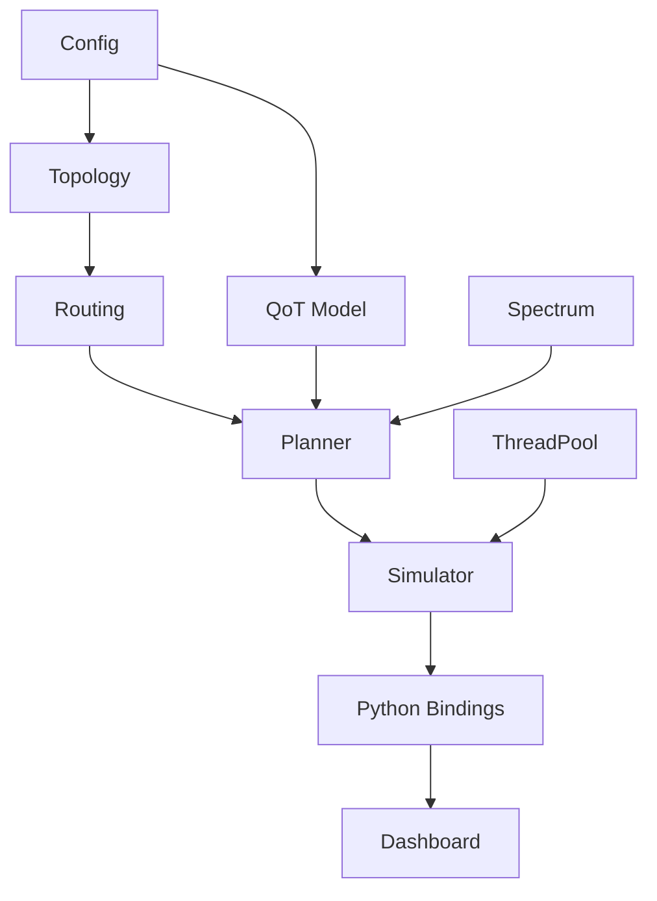

# Architecture

## High-Level Module Diagram

```
┌──────────────────────────────────────────────────────────────────┐
│                        User Interface                            │
│  ┌─────────────┐                                                 │
│  │  Dashboard   │  Streamlit + Plotly                             │
│  │  (Phase 6)   │  Topology view, spectrum heatmap, metrics      │
│  └──────┬───────┘                                                │
│         │                                                        │
│  ┌──────▼───────┐                                                │
│  │ Python API   │  pybind11 bindings (Phase 6)                   │
│  │  `optiplan`  │                                                │
│  └──────┬───────┘                                                │
└─────────┼────────────────────────────────────────────────────────┘
          │
┌─────────▼────────────────────────────────────────────────────────┐
│                     C++ Core Library                              │
│                                                                   │
│  ┌────────────┐  ┌────────────┐  ┌────────────┐  ┌────────────┐ │
│  │  Topology   │  │  Routing   │  │  Spectrum  │  │    QoT     │ │
│  │  Loader     │  │ (Yen KSP)  │  │  (Bitsets) │  │  (GNModel) │ │
│  └────────────┘  └────────────┘  └────────────┘  └────────────┘ │
│                                                                   │
│  ┌────────────┐  ┌────────────┐  ┌────────────┐  ┌────────────┐ │
│  │  Planner   │  │ Simulator  │  │ ThreadPool │  │   Config   │ │
│  │ (RMSA)     │  │ (Events)   │  │ (Phase 4)  │  │  (JSON)    │ │
│  └────────────┘  └────────────┘  └────────────┘  └────────────┘ │
│                                                                   │
│  ┌────────────────────────────────────────────────────────────┐  │
│  │                 ML QoT Estimator (Phase 5)                 │  │
│  │  Dataset gen → Train (Python) → Inference (C++/ONNX)      │  │
│  └────────────────────────────────────────────────────────────┘  │
└──────────────────────────────────────────────────────────────────┘
```

## Design Principles

- **RAII everywhere**: No raw owning pointers. Use `std::unique_ptr` / `std::shared_ptr`.
- **`const`-correctness**: Every function that does not modify state is `const`.
- **Strategy pattern**: `IQoTModel` and `IPlanner` are interfaces; implementations are
  swappable without touching client code.
- **No global mutable state**: All state lives in explicitly owned objects.
- **Config-driven**: Every physical parameter is loaded from JSON, not hard-coded.
- **Pure evaluation functions**: QoT calculations are pure (no side effects), enabling
  safe concurrent evaluation.

## Module Dependencies



---

*This document will be refined as modules are implemented.*
